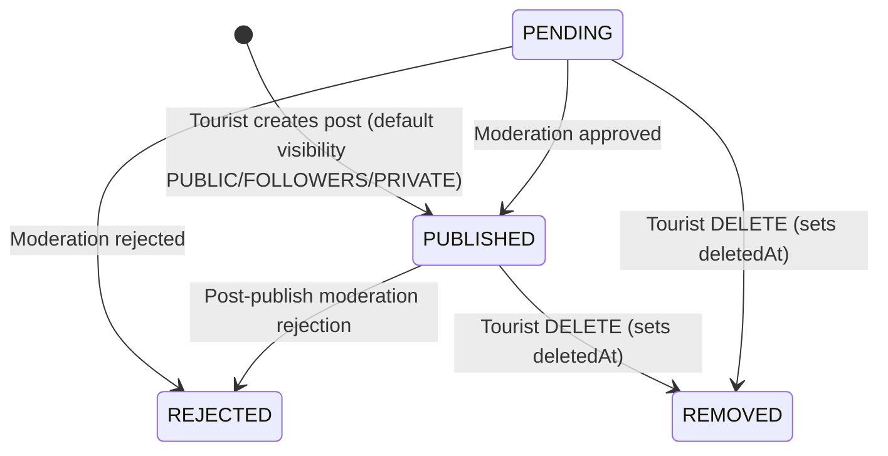

# Social Posts & Community Feed API Documentation (Day 13)

This document specifies the **Social Feed Architecture** and **Tourist Post Management** APIs in the Kerala Tourism backend modular monolith.

> [!NOTE]
> **Scope Boundary (Day 13)**: Covers core post authoring, visibility/moderation lifecycle, safe media and destination associations, BOLA-protected edits/deletions, and chronological paginated public feeds. Social engagement features (likes, comments, reposts, follower graphs, bookmarks, messaging) belong to later stages (Day 14+).

---

## 1. Architecture Overview

The module resides at `server/src/modules/posts/` and follows strict separation of concerns:

- **Routes (`post.routes.ts`)**: Exposes separate public (`postRoutes` mounted at `/api/v1/posts`) and authenticated tourist (`touristPostRoutes` mounted at `/api/v1/tourist/posts`) routers with rate limiting, JWT authentication, RBAC guards, and Zod validators.
- **Validation (`post.validation.ts`)**: Enforces strict (`.strict()`) Zod schemas across request bodies, route parameters (`ObjectId`), and query strings, rejecting injected ownership (`authorId`), lifecycle (`status`, `deletedAt`), and unrecognized fields.
- **Controllers (`post.controller.ts`)**: Parses verified requests and maps domain responses into standardized HTTP status codes and API wrappers.
- **Service (`post.service.ts`)**: Derives `authorId` strictly from `req.user.id`, verifies active `TOURIST` account status, validates `Media` ownership/eligibility and `Destination` publication status, executes soft deletion, enforces `assertOwnership(..., { concealWithNotFound: true })`, and batch-hydrates safe public DTOs.
- **Repository (`post.repository.ts`)**: Encapsulates MongoDB queries, ESR-aligned pagination (`.skip().limit()`), and selective public profile projections (`accountId`, `firstName`, `lastName`, `profileImage`).
- **Model (`post.model.ts`)**: Defines the canonical `PostModel` (collection `'posts'`), schema constraints, validation guards, and four partial/compound indexes.

---

## 2. Post Data Model & Lifecycle

### 2.1 Fields (`posts` collection)

| Field | Type | Constraints / Default | Description |
|---|---|---|---|
| `_id` | `ObjectId` | Auto-generated | Unique post identifier |
| `authorId` | `ObjectId` | Required, Immutable, Ref `Account` | Authenticated tourist author (`req.user.id`) |
| `content` | `String` | Required, trimmed, 1–2000 chars | Text story / caption |
| `mediaIds` | `Array<ObjectId>` | Default `[]`, max 10 unique IDs, Ref `Media` | Associated uploaded media references |
| `destinationId` | `ObjectId \| null` | Optional, default `null`, Ref `Destination` | Optional verified/published destination link |
| `visibility` | `String` | `PUBLIC \| FOLLOWERS \| PRIVATE`, default `PUBLIC` | Audience visibility scope |
| `status` | `String` | `PENDING \| PUBLISHED \| REJECTED \| REMOVED`, default `PUBLISHED` | Moderation & deletion lifecycle state |
| `publishedAt` | `Date \| null` | Server-assigned on publish | Publication timestamp used for chronological sorting |
| `deletedAt` | `Date \| null` | Default `null` | Soft-deletion timestamp |
| `createdAt` | `Date` | Mongoose timestamp | Creation timestamp |
| `updatedAt` | `Date` | Mongoose timestamp | Last update timestamp |

> No unbounded activity arrays (`likes`, `comments`, `reposts`) or duplicated user/destination objects are embedded inside post documents.

### 2.2 Visibility & Status State Lifecycle



- **Public Feed Eligibility**: Only documents matching `visibility = PUBLIC`, `status = PUBLISHED`, and `deletedAt = null` appear in `GET /api/v1/posts` and `GET /api/v1/posts/:postId`.
- **Tourist Owner Visibility**: Tourists can list and read their own non-removed posts regardless of visibility (`PUBLIC`, `FOLLOWERS`, `PRIVATE`) or `PENDING`/`REJECTED` moderation status via `/api/v1/tourist/posts`.

---

## 3. MongoDB Indexing Decisions

All indexes in [`post.model.ts`](file:///c:/Users/aysha/Downloads/New%20folder/server/src/modules/posts/post.model.ts) follow the **ESR (Equality, Sort, Range)** rule and omit duplicate single-field inline declarations:

1. **`idx_public_feed`**: `{ visibility: 1, status: 1, deletedAt: 1, publishedAt: -1, _id: -1 }` with `partialFilterExpression: { visibility: 'PUBLIC', status: 'PUBLISHED' }`
   - Optimizes `GET /api/v1/posts` chronological feed scans without sorting in memory or indexing private/pending/rejected posts.
2. **`idx_author_posts`**: `{ authorId: 1, deletedAt: 1, createdAt: -1 }`
   - Powers `GET /api/v1/tourist/posts` ("My Posts") ordered newest-first per user.
3. **`idx_destination_posts`**: `{ destinationId: 1, visibility: 1, status: 1, deletedAt: 1, publishedAt: -1 }` with `partialFilterExpression: { destinationId: { $type: 'objectId' }, visibility: 'PUBLIC', status: 'PUBLISHED' }`
   - Optimizes `?destinationId=...` feed queries while excluding text-only/untagged posts from the index.
4. **`idx_moderation_queue`**: `{ status: 1, createdAt: -1 }` with `partialFilterExpression: { status: { $in: ['PENDING', 'REJECTED'] } }`
   - Supports moderator triage queues without storing index entries for active published posts.

---

## 4. API Endpoints

### 4.1 `POST /api/v1/tourist/posts` — Create Post
- **Authentication & RBAC**: `postCreationRateLimiter` (20 req / 15 min per IP), `authenticate`, `requireActiveAccount`, `requireAccountType('TOURIST')`
- **Request Body (`createPostSchema.strict()`)**:
```json
{
  "content": "Misty sunrise overlooking Tea Valley in Munnar.",
  "mediaIds": ["66e04d3e89a4b2c1d8e1f055"],
  "destinationId": "66e04d3e89a4b2c1d8e1f010",
  "visibility": "PUBLIC"
}
```
- **Response (`201 Created`)**:
```json
{
  "success": true,
  "message": "Post created successfully",
  "data": {
    "id": "66e04d3e89a4b2c1d8e1f099",
    "authorId": "66e04d3e89a4b2c1d8e1f001",
    "author": {
      "id": "66e04d3e89a4b2c1d8e1f001",
      "firstName": "Meera",
      "lastName": "Krishnan",
      "displayName": "Meera Krishnan",
      "profileImage": "https://cdn.keralatourism.org/avatars/meera.jpg"
    },
    "content": "Misty sunrise overlooking Tea Valley in Munnar.",
    "mediaIds": ["66e04d3e89a4b2c1d8e1f055"],
    "media": [
      {
        "id": "66e04d3e89a4b2c1d8e1f055",
        "url": "https://cdn.keralatourism.org/media/general/munnar-dawn.webp",
        "mimeType": "image/webp",
        "fileSizeBytes": 420100,
        "dimensions": { "width": 1600, "height": 1066 }
      }
    ],
    "destinationId": "66e04d3e89a4b2c1d8e1f010",
    "destination": {
      "id": "66e04d3e89a4b2c1d8e1f010",
      "name": "Munnar Tea Gardens",
      "slug": "munnar-tea-gardens",
      "district": "Idukki",
      "locality": "Devikulam",
      "primaryImage": "https://cdn.keralatourism.org/destinations/munnar.webp"
    },
    "visibility": "PUBLIC",
    "status": "PUBLISHED",
    "publishedAt": "2026-11-11T05:00:00.000Z",
    "createdAt": "2026-11-11T05:00:00.000Z",
    "updatedAt": "2026-11-11T05:00:00.000Z"
  }
}
```

### 4.2 `GET /api/v1/posts` — Public Feed
- **Access**: Public
- **Query Params (`publicPostsFeedQuerySchema.strict()`)**:
  - `page` (int $\ge 1$, default `1`)
  - `limit` (int `1..50`, default `10`)
  - `destinationId` (optional 24-hex ObjectId)
- **Sorting**: Newest first (`publishedAt DESC`, `_id DESC`)
- **Pagination Response (`200 OK`)**: `{ success: true, data: PostDto[], pagination: { page, limit, total, totalPages } }`

### 4.3 `GET /api/v1/posts/:postId` — Public Single Post
- **Access**: Public
- **Validation**: `postId` must be a 24-hex ObjectId (`400 VALIDATION_ERROR` otherwise).
- **Behavior**: Returns `200 OK` only when `visibility === 'PUBLIC'`, `status === 'PUBLISHED'`, and `deletedAt === null`; otherwise returns `404 RESOURCE_NOT_FOUND`.

### 4.4 `GET /api/v1/tourist/posts` — Authenticated Tourist's Own Posts
- **Access**: Authenticated active `TOURIST`
- **Query Params**: `page`, `limit`, optional `visibility`, optional `status` (`PENDING | PUBLISHED | REJECTED`).
- **Response (`200 OK`)**: Paginated list of own non-removed posts sorted newest first (`createdAt DESC`).

### 4.5 `GET /api/v1/tourist/posts/:postId` — Retrieve Own Post
- **Access**: Authenticated active `TOURIST` (owner only)
- **BOLA Guard**: Returns `404 RESOURCE_NOT_FOUND` if the post does not exist, is removed, or belongs to a different author.

### 4.6 `PATCH /api/v1/tourist/posts/:postId` — Update Own Post
- **Access**: Authenticated active `TOURIST` (owner only)
- **Body (`updatePostSchema.strict()`)**: Any subset of `{ content, mediaIds, destinationId (ObjectId | null), visibility }`. Rejected (`REJECTED`) posts return `403 POST_REJECTED`.

### 4.7 `DELETE /api/v1/tourist/posts/:postId` — Soft-Delete Own Post
- **Access**: Authenticated active `TOURIST` (owner only)
- **Behavior**: Marks `status = 'REMOVED'` and sets `deletedAt` timestamp. Immediately excluded from public and personal active queries.

---

## 5. Authentication, Authorization & Security Controls

1. **Role & Account Status Isolation**: Only `ACTIVE` `TOURIST` accounts may access `/api/v1/tourist/posts`. `BUSINESS`, `ADMIN`, `SUSPENDED`, and `DEACTIVATED` accounts receive `403`.
2. **Server-Side Identity Derivation**: `authorId` is exclusively populated from `req.user.id`. Client-submitted `authorId`, `userId`, `status`, or extra fields are rejected via Zod `.strict()`.
3. **BOLA / IDOR Concealment**: Accessing, editing, or deleting another tourist's post on `/api/v1/tourist/posts/:postId`, or requesting a `PRIVATE`, `FOLLOWERS`, `REJECTED`, or `REMOVED` post on `/api/v1/posts/:postId`, returns `404 RESOURCE_NOT_FOUND`.
4. **Rate Limiting**: `postCreationRateLimiter` caps `POST /api/v1/tourist/posts` at 20 requests per 15-minute window per IP (`429 TOO_MANY_REQUESTS`).
5. **Sensitive Data Redaction**: Hydrated posts never expose account `email`, `passwordHash`, refresh tokens, or media `storageKey` values.

---

## 6. Media & Destination Association Rules

### Media Association (`MediaModel`)
- Reuses [`MediaModel`](file:///c:/Users/aysha/Downloads/New%20folder/server/src/modules/media/media.model.ts) (`collection: 'media'`).
- Validates:
  - Media existence (`404 MEDIA_NOT_FOUND` if missing).
  - Ownership (`media.uploaderAccountId === req.user.id`, else `403 UNAUTHORIZED_MEDIA_ACCESS`).
  - Moderation & eligibility (`media.isModerated === true`, valid HTTP/HTTPS URL, no restricted `private/` or `kyc/` keys, and destination consistency if `media.destinationId` is set).
  - Supported MIME type (`image/jpeg`, `image/png`, `image/webp`, `image/avif`) and file size (`<= 5 MB`).
  - Duplicate IDs are deduplicated preserving insertion order up to a maximum of 10 media references per post.
- **Known Limitation**: Multipart binary file upload endpoints are not yet implemented in `modules/media/`; post creation currently associates pre-registered/validated `Media` documents via `mediaIds`.

### Destination Association (`DestinationModel`)
- Optional `destinationId` reference validated as a 24-hex ObjectId.
- Verifies destination existence (`404 DESTINATION_NOT_FOUND`) and requires both `verificationStatus === 'VERIFIED'` and `publicationStatus === 'PUBLISHED'` (`400 VALIDATION_ERROR` otherwise).
- Arbitrary client destination text fields are rejected by `.strict()` schemas; destination summaries are hydrated exclusively from the canonical database record.

---

## 7. Error Responses

| HTTP Status | Error Code | Trigger Condition |
|---|---|---|
| `400` | `VALIDATION_ERROR` | Invalid ObjectId, missing/oversized content, injected `authorId`/`status`, unexpected fields, unpublished destination, unmoderated/oversized media |
| `401` | `AUTHENTICATION_REQUIRED` | Missing or invalid bearer access token |
| `403` | `FORBIDDEN_ACCOUNT_TYPE` | Business or Admin account calling `/api/v1/tourist/posts` |
| `403` | `ACCOUNT_SUSPENDED` / `ACCOUNT_DEACTIVATED` | Non-active authenticated account |
| `403` | `UNAUTHORIZED_MEDIA_ACCESS` | Associating media uploaded by another user |
| `403` | `POST_REJECTED` | Attempting to edit a moderator-rejected post |
| `404` | `RESOURCE_NOT_FOUND` | Missing post, non-public/removed post on public routes, or non-owned post on `/tourist/posts/:postId` |
| `404` | `MEDIA_NOT_FOUND` / `DESTINATION_NOT_FOUND` | Referenced media or destination ID does not exist |
| `429` | `TOO_MANY_REQUESTS` | Exceeded post creation rate limit (`20 / 15 min`) |
