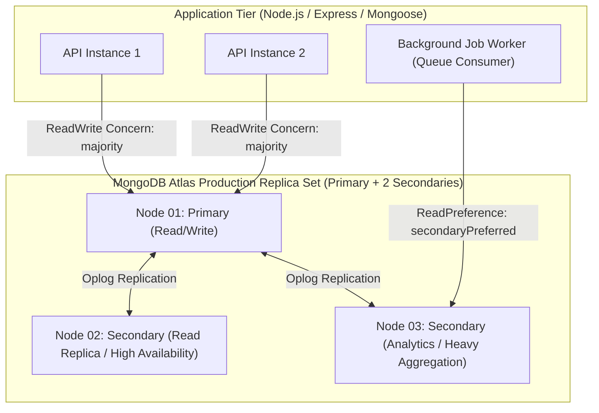

# Kerala Tourism Ecosystem — Database Architecture & Data Blueprint
**System:** Kerala Tourism Digital Platform  
**Target Engine:** MongoDB Atlas (v7.0+ Replica Set / Distributed Cluster)  
**ORM / ODM:** Mongoose ODM (v8.x) with Strict TypeScript Schemas  
**Operating Timezone:** Asia/Kolkata (IST, UTC+05:30) | **Storage Timezone:** UTC (`ISODate`)  
**Architecture Paradigm:** Domain-Driven Modular Monolith, Bounded Document Referencing, Zero Unbounded Arrays  

---

## 1. Executive Summary & Architectural Manifesto

The Kerala Tourism digital ecosystem coordinates travelers, accredited hospitality merchants (homestays, houseboats, eco-resorts, and licensed travel agencies), and the Kerala State Tourism Directorate into a unified digital marketplace. 

The database architecture is designed to fulfill five fundamental non-negotiable operational requirements:
1. **Strict Multi-Tenant Identity Segregation**: Central authentication credentials (`accounts`) are strictly segregated from domain profile entities (`touristProfiles`, `businessProfiles`, `adminProfiles`). Users cannot escalate privileges through profile alterations.
2. **Dual-Mode Accommodation Availability**: Native support for **Hourly Transit Stays** (3h, 6h, and 12h slots) and **Daily Overnight Stays** (12:00 PM check-in, 11:00 AM check-out), enforcing an automated **60-minute housekeeping buffer** to eliminate turnover collisions.
3. **Guaranteed Booking Concurrency**: Prevention of arbitrary interval overlaps through a hybrid concurrency control model combining multi-document ACID transactions, discrete temporal interval validation, and 15-minute temporary reservation holds (`inventoryHolds`).
4. **Geospatial Rigor**: OpenGIS-compliant GeoJSON Point structures with `2dsphere` indexes, isolating unverified community-submitted coordinates from verified tourism destination records.
5. **Regulatory & PII Compliance**: Complete avoidance of raw cardholder payment data (PCI-DSS compliance via payment gateway tokenization) and strict encryption/masking of government identifiers (Aadhaar, Passport) under Indian Digital Personal Data Protection (DPDP) standards.

---

## 2. Cluster Topology & Environment Architecture

### Replica Set Configuration & Sizing
- **Replica Set Members**: 3-node replica set (1 Primary, 2 Secondaries across multiple availability zones in AWS Mumbai `ap-south-1`).
- **Read & Write Concerns**:
  - **Financial Transactions & Bookings**: `w: 'majority'`, `j: true` (journaled write to disk), read concern `'linearizable'` or `'majority'` to prevent dirty reads.
  - **Social Feed & Destination Browsing**: `w: 1`, read preference `'secondaryPreferred'` to offload analytical and read-heavy workloads from the Primary.
- **Connection Pool**: Mongoose connection pool configured with `maxPoolSize: 100`, `minPoolSize: 10`, `serverSelectionTimeoutMS: 5000`, `connectTimeoutMS: 10000`.

---

## 3. Global Naming & Modeling Conventions

| Aspect | Convention | Example |
|---|---|---|
| **Collection Names** | Lower camelCase, Plural noun | `accounts`, `destinationSubmissions`, `inventoryHolds` |
| **Document IDs** | BSON `ObjectId` (12-byte hex) | `_id: ObjectId("66e04d3e89a4b2c1d8e1f001")` |
| **Field Names** | Lower camelCase | `createdAt`, `checkInTime`, `durationHours` |
| **Foreign References** | Entity name + `Id` as `ObjectId` | `touristId`, `propertyId`, `roomId` |
| **Timestamps** | UTC `ISODate`, Mongoose `{ timestamps: true }` | `createdAt: ISODate("2026-11-10T06:00:00Z")` |
| **Status Enums** | Uppercase snake_case string literals | `PENDING_APPROVAL`, `VERIFIED`, `REJECTED` |
| **Currency & Monetary** | Integer subunits (Paise) or Double with exact cents | `baseRate: 3200.00`, `currency: 'INR'` |
| **GeoJSON Format** | GeoJSON Point `[longitude, latitude]` | `{ type: "Point", coordinates: [76.8921, 10.0124] }` |

---

## 4. Documentation Suite Navigation

The complete architecture specification is partitioned into modular technical design documents:

1. [**`collections.md`**](file:///c:/Users/aysha/Downloads/New%20folder/docs/database/collections.md)  
   Exhaustive field-by-field dictionary for all **51 collections**, covering BSON types, validation rules, references, and production JSON examples.
2. [**`relationships.md`**](file:///c:/Users/aysha/Downloads/New%20folder/docs/database/relationships.md)  
   Entity-relationship architecture, bounded referencing strategies, embedding criteria, and domain ER diagrams.
3. [**`indexing-strategy.md`**](file:///c:/Users/aysha/Downloads/New%20folder/docs/database/indexing-strategy.md)  
   Complete index catalog across all collections (Unique, Compound, `2dsphere`, TTL, and Partial Filter indexes).
4. [**`booking-data-model.md`**](file:///c:/Users/aysha/Downloads/New%20folder/docs/database/booking-data-model.md)  
   Deep-dive on dual-mode hourly/daily reservations, 60-minute housekeeping buffers, 15-minute countdown SLAs, and ACID transaction concurrency.
5. [**`security-considerations.md`**](file:///c:/Users/aysha/Downloads/New%20folder/docs/database/security-considerations.md)  
   Account privilege partitioning, SHA-256 token hashing, DPDP Act PII masking, PCI-DSS compliance, and immutable audit logs.
