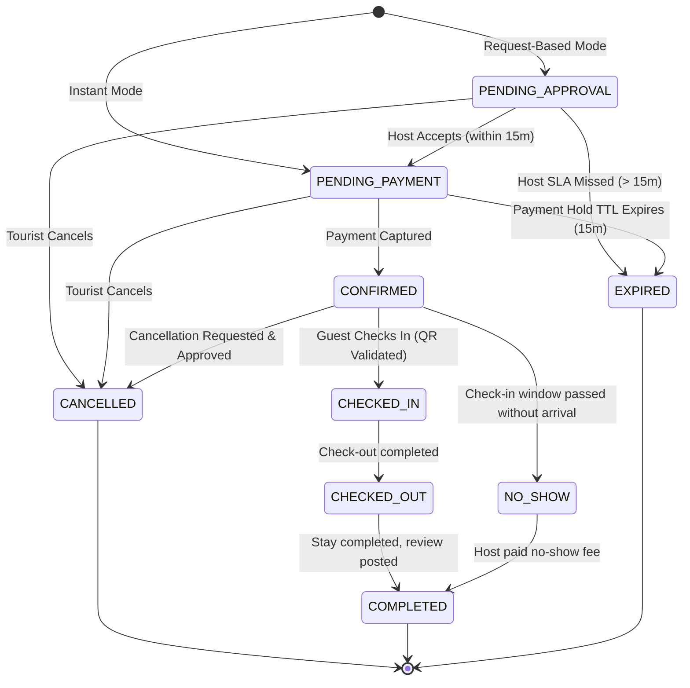
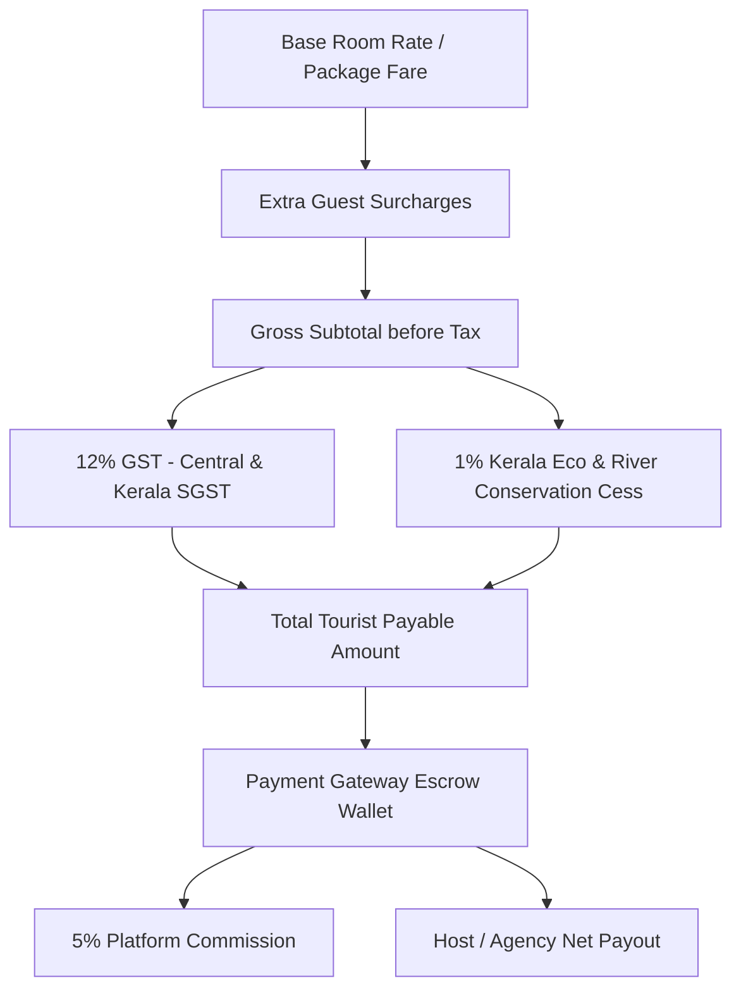
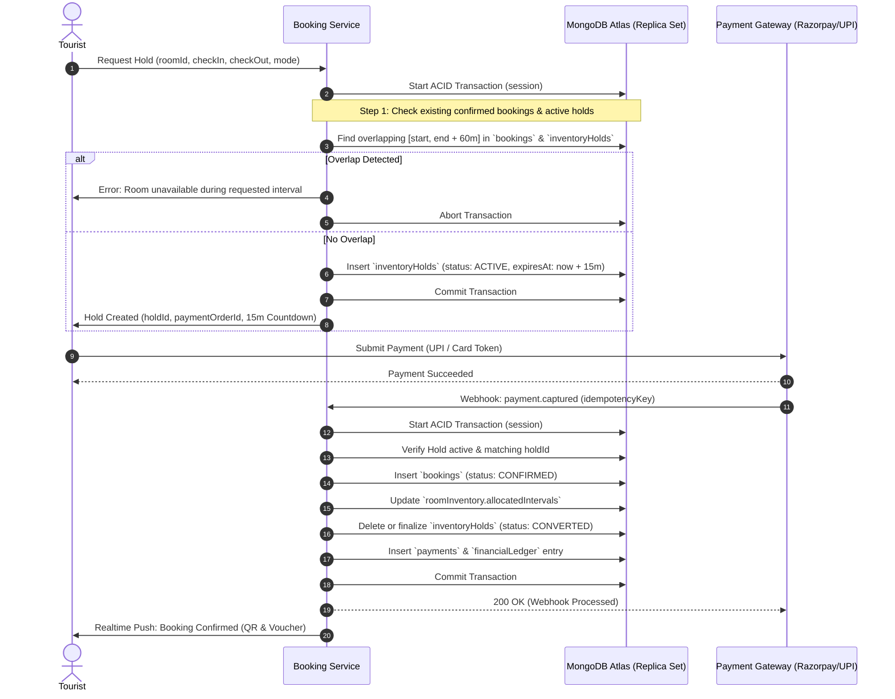

# Booking Data Model & Concurrency Architecture

## 1. Executive Summary

The Kerala Tourism digital ecosystem features a specialized **Dual-Mode Accommodation Engine** and an **Integrated Package Tour Booking Pipeline**. The accommodation system supports both **hourly transit stays** (designed for travelers needing 3-hour, 6-hour, or 12-hour rest near transit hubs like Kochi Airport, Alappuzha boat jetties, or railway junctions) and **daily overnight stays** (standard 12:00 PM check-in to 11:00 AM check-out).

To eliminate double-bookings across overlapping time intervals while maintaining sub-second booking latency under high peak tourism loads (e.g., Onam, Nehru Trophy Boat Race season), the architecture combines:
1. **Multi-Document ACID Transactions** (`session.withTransaction()`).
2. **Atomic Interval Collision Detection** including a mandatory **60-minute turnover housekeeping buffer**.
3. **Idempotent 15-minute Inventory Holds** with MongoDB TTL eviction.
4. **State Machine Partitioning** across booking, payment, approval, and inventory states.

---

## 2. Temporal & Timezone Representation Standards

### 2.1 UTC Storage Standard
All temporal values stored within MongoDB collections (`bookings`, `inventoryHolds`, `roomInventory`, `payments`, etc.) **MUST be stored as native BSON UTC Dates (`ISODate`)**.

- No local timezone string representations (e.g. `2026-11-10T12:00:00+05:30`) are persisted in date fields.
- Storing strictly UTC prevents drift during daylight saving conversions (for international tourists) and guarantees uniform index comparisons.

### 2.2 Operating Timezone: `Asia/Kolkata` (IST, UTC+05:30)
Business operational policies operate strictly according to Indian Standard Time (`Asia/Kolkata`):
- **Daily Check-In Standard**: `12:00:00 IST` (which is `06:30:00 UTC`).
- **Daily Check-Out Standard**: `11:00:00 IST` (which is `05:30:00 UTC` next calendar day).
- **Turnover Housekeeping Buffer**: 60 minutes (`BOOKING_RULES.TURNOVER_BUFFER_MINUTES: 60`).
- **Hourly Transit Durations**: Strictly `3`, `6`, or `12` hours (`BOOKING_RULES.HOURLY_SLOT_DURATIONS_HOURS`).
- **Host SLA Response Window**: 900 seconds / 15 minutes (`BOOKING_RULES.REQUEST_RESPONSE_SLA_SECONDS: 900`).

---

## 3. Booking Modes & Behavioral Specifications

### 3.1 Daily Accommodation Booking
- **Check-in**: Day $D$ at 12:00 IST (06:30 UTC).
- **Check-out**: Day $D + N$ at 11:00 IST (05:30 UTC).
- **Housekeeping Turnover Window**: 11:00 IST to 12:00 IST (60 minutes).
- **Inventory Unit**: Room Day Block ($1 \text{ room} \times N \text{ calendar nights}$).

### 3.2 Hourly Transit Stay Booking
- **Permitted Durations**: 3 hours, 6 hours, or 12 hours.
- **Check-in**: Any host-configured operating hour (e.g., 08:00, 14:00, 20:00 IST).
- **Check-out**: $\text{Check-in Time} + \text{Duration (3h, 6h, 12h)}$.
- **Housekeeping Turnover Buffer**: An automated 60-minute maintenance window is appended immediately to the checkout time before that specific room can be released for subsequent bookings:
  $$\text{Effective Reserved Until} = \text{Check-Out Time} + 60\text{ minutes}$$

### 3.3 Instant vs. Request-Based Bookings
1. **Instant Booking (`bookingMode: "INSTANT"`)**:
   - Authorized when property/agency sets `instantBookingEnabled: true`.
   - The tourist places an inventory hold, completes payment within 15 minutes, and the booking is immediately marked `CONFIRMED`.
2. **Request-Based Booking (`bookingMode: "REQUEST"`)**:
   - Required for specialized homestays, eco-villas, or chartered houseboats.
   - Hold placed $\rightarrow$ Host receives real-time notification $\rightarrow$ Host has a strict **15-minute countdown SLA** (`approvalDeadline = createdAt + 15m`) to accept or decline.
   - If accepted: Tourist has 15 minutes from approval to authorize payment.
   - If host does not respond within 15 minutes: Auto-expires to `REJECTED_TIMEOUT` and release hold.

---

## 4. State Machines & Lifecycle Transitions

### 4.1 Booking Status Lifecycle (`bookingStatus`)



### 4.2 State Taxonomy

| Category | States | Description |
|---|---|---|
| **Booking State** (`bookingStatus`) | `PENDING_APPROVAL`, `PENDING_PAYMENT`, `CONFIRMED`, `CHECKED_IN`, `CHECKED_OUT`, `COMPLETED`, `CANCELLED`, `EXPIRED`, `NO_SHOW` | Overall life-cycle status of the tourist reservation. |
| **Payment State** (`paymentStatus`) | `PENDING`, `AUTHORIZED`, `CAPTURED`, `FAILED`, `REFUNDED`, `PARTIALLY_REFUNDED`, `DISPUTED` | Gateway settlement status. |
| **Host Approval State** (`approvalStatus`) | `NOT_REQUIRED`, `PENDING`, `APPROVED`, `REJECTED`, `EXPIRED` | For request-based bookings requiring host confirmation. |
| **Inventory State** (`inventoryStatus`) | `AVAILABLE`, `HOLD`, `ALLOCATED`, `MAINTENANCE`, `BLOCKED` | Room physical occupancy status. |

---

## 5. Pricing Architecture & Financial Math

Kerala Tourism transactions enforce strict transparency, splitting taxes, eco-tourism levies, and commission schedules.



### 5.1 Formulation
Let $B$ be Base Room / Package Rate for duration $D$.  
Let $E$ be Extra Guest Charges ($G_{\text{extra}} \times \text{Rate}_{\text{extra}}$).  
1. **Subtotal ($S$)**:
   $$S = B + E$$
2. **Goods and Services Tax (GST)**:
   $$\text{GST} = \text{round}(S \times 0.12, 2) \quad (\text{6% CGST} + \text{6% SGST})$$
3. **Kerala Eco-Tourism & Flood Mitigation Cess**:
   $$\text{Cess} = \text{round}(S \times 0.01, 2) \quad (1\%)$$
4. **Total Traveler Payable ($T$)**:
   $$T = S + \text{GST} + \text{Cess}$$
5. **Platform Commission ($C$)**:
   $$C = \text{round}(S \times 0.05, 2) \quad (\text{5% platform fee on subtotal})$$
6. **Provider Net Payout ($P_{\text{net}}$)**:
   $$P_{\text{net}} = T - C - \text{Gateway Charges}$$

---

## 6. Overlapping Reservation Prevention & Concurrency Engine

### 6.1 The Interval Overlap Challenge
Unique database indexes such as `{ roomId: 1, checkInDate: 1 }` only protect exact matching start dates. They fail to prevent arbitrary interval collisions:
- **Scenario A**: Traveler 1 books 10:00 to 14:00. Traveler 2 requests 12:00 to 16:00.
- **Scenario B**: Traveler 1 books Hourly Transit 09:00 to 12:00. Room checkout has a 60-min buffer (ends 13:00). Daily overnight guest check-in begins at 12:00 (Collision!).

### 6.2 The Mathematical Overlap Formula
Two intervals $[A_{\text{start}}, A_{\text{end}}]$ and $[B_{\text{start}}, B_{\text{end}}]$ collide if and only if:
$$\text{Overlap} \iff (A_{\text{start}} < B_{\text{end}}) \land (A_{\text{end}} > B_{\text{start}})$$

When incorporating the **Housekeeping Turnover Buffer** ($\Delta = 60\text{ minutes}$):
$$A_{\text{effective\_end}} = A_{\text{end}} + \Delta$$
$$\text{Collision} \iff (\text{New}_{\text{start}} < A_{\text{effective\_end}}) \land (\text{New}_{\text{effective\_end}} > A_{\text{start}})$$

### 6.3 Dual-Stage Concurrency Guard Architecture



---

## 7. MongoDB Transaction Implementation Pattern

Below is the production TypeScript pattern for atomic reservation holds inside a Mongoose transaction session:

```typescript
import mongoose, { ClientSession } from 'mongoose';
import { BOOKING_RULES } from '@kerala-tourism/constants';

interface CreateHoldInput {
  roomId: mongoose.Types.ObjectId;
  guestId: mongoose.Types.ObjectId;
  bookingType: 'HOURLY' | 'DAILY';
  checkIn: Date;
  checkOut: Date;
}

export async function createAtomicInventoryHold(input: CreateHoldInput) {
  const session: ClientSession = await mongoose.startSession();
  session.startTransaction({
    readPreference: 'primary',
    readConcern: { level: 'snapshot' },
    writeConcern: { w: 'majority' }
  });

  try {
    const bufferMinutes = BOOKING_RULES.TURNOVER_BUFFER_MINUTES; // 60 mins
    const bufferMs = bufferMinutes * 60 * 1000;
    
    // Requested effective window including buffer
    const requestedStart = input.checkIn;
    const requestedEffectiveEnd = new Date(input.checkOut.getTime() + bufferMs);

    // 1. Query Confirmed Bookings for interval collisions
    const overlappingBooking = await mongoose.model('Booking').findOne({
      roomId: input.roomId,
      status: { $in: ['CONFIRMED', 'CHECKED_IN'] },
      $expr: {
        $and: [
          { $lt: ['$checkInTime', requestedEffectiveEnd] },
          { $gt: [{ $add: ['$checkOutTime', bufferMs] }, requestedStart] }
        ]
      }
    }).session(session);

    if (overlappingBooking) {
      throw new Error('ROOM_ALREADY_RESERVED');
    }

    // 2. Query Active Inventory Holds for collisions
    const overlappingHold = await mongoose.model('InventoryHold').findOne({
      roomId: input.roomId,
      status: 'ACTIVE',
      expiresAt: { $gt: new Date() },
      $expr: {
        $and: [
          { $lt: ['$checkInTime', requestedEffectiveEnd] },
          { $gt: [{ $add: ['$checkOutTime', bufferMs] }, requestedStart] }
        ]
      }
    }).session(session);

    if (overlappingHold) {
      throw new Error('ROOM_TEMPORARILY_LOCKED_BY_ANOTHER_TRAVELER');
    }

    // 3. Insert new 15-minute hold
    const expiresAt = new Date(Date.now() + BOOKING_RULES.REQUEST_RESPONSE_SLA_SECONDS * 1000);
    const [hold] = await mongoose.model('InventoryHold').create([
      {
        roomId: input.roomId,
        guestId: input.guestId,
        bookingType: input.bookingType,
        checkInTime: input.checkIn,
        checkOutTime: input.checkOut,
        effectiveUntil: requestedEffectiveEnd,
        status: 'ACTIVE',
        expiresAt: expiresAt
      }
    ], { session });

    await session.commitTransaction();
    return hold;
  } catch (error) {
    await session.abortTransaction();
    throw error;
  } finally {
    await session.endSession();
  }
}
```

---

## 8. Idempotency & Webhook Double-Processing Protection

Payment gateways (such as Razorpay or Stripe) retry webhooks upon network timeouts, risking duplicate bookings or double-credits.

1. **Idempotency Keys**:
   - Every payment webhook and manual retry contains an `idempotencyKey` formatted as: `GATEWAY_EVENT_ID + "_" + PAYMENT_ID`.
2. **Unique Compound Constraint**:
   - The `payments` collection enforces:
     `{ gatewayTransactionId: 1 }` (unique)
     `{ idempotencyKey: 1 }` (unique)
3. **Optimistic Concurrency Control**:
   - The `bookings` document increments `version: { type: Number, default: 0 }` (`__v`).
   - Transitioning from `PENDING_PAYMENT` to `CONFIRMED` executes with:
     ```typescript
     const updated = await Booking.findOneAndUpdate(
       { _id: bookingId, status: 'PENDING_PAYMENT' },
       { $set: { status: 'CONFIRMED', paymentId: payment._id } },
       { new: true, session }
     );
     if (!updated) {
       // Already processed by earlier concurrent webhook - return 200 OK
       return;
     }
     ```

---

## 9. Cancellation, Refunds & Ledger Accounting

1. **Cancellation Policies**:
   - **Flexible**: Full refund up to 24 hours prior to check-in.
   - **Moderate**: Full refund up to 5 days prior; 50% thereafter.
   - **Strict**: No refund within 7 days of check-in.
   - **Hourly Transit**: Full refund up to 2 hours prior to slot; zero refund within 2 hours.
2. **Double-Entry Financial Ledger (`financialLedger`)**:
   - Every monetary transaction generates equal debit and credit entries in the immutable ledger.
   - Example when booking is confirmed:
     - Debit: `ESCROW_ASSETS` (₹5,650)
     - Credit: `TOURIST_RECEIVABLES` (₹5,650)
   - Example when stay completed:
     - Debit: `ESCROW_ASSETS` (₹5,650)
     - Credit: `PLATFORM_COMMISSION_REVENUE` (₹250)
     - Credit: `GOVERNMENT_TAX_LIABILITY` (₹650)
     - Credit: `HOST_PAYOUT_PAYABLE` (₹4,750)
