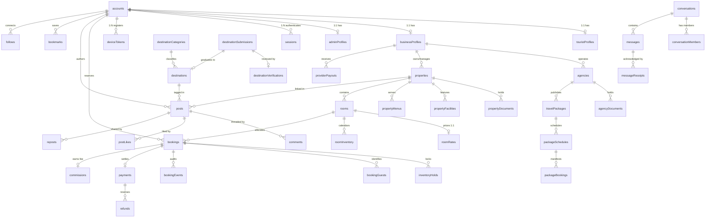

# Entity Relationships & Document Referencing Strategy
**Kerala Tourism Ecosystem**  
**Design Standard:** Strict Avoidance of Unbounded Embedding, Normalized Relational Integrity, Cross-Domain Junction Models  

---

## 1. Embedding vs. Referencing Decision Matrix

A foundational principle of high-performance MongoDB architecture is knowing when to embed documents versus when to reference them across distinct collections.

```
┌─────────────────────────────────────────────────────────────────────────────┐
│                   EMBEDDING VS. REFERENCING CRITERIA                        │
├─────────────────────┬────────────────────────────────┬──────────────────────┤
│ Strategy            │ When to Use (Embed)            │ When to Avoid        │
├─────────────────────┼────────────────────────────────┼──────────────────────┤
│ Embedded Document   │ 1. 1-to-few relationship       │ 1. Unbounded growth  │
│ (Sub-document /     │    (< 10 items)                │    (Likes, Comments, │
│ Array of Objects)   │ 2. Data is almost always read  │    Messages)         │
│                     │    together with parent        │ 2. Data is queried   │
│                     │ 3. Data has no independent     │    independently     │
│                     │    lifecycle (e.g., GeoJSON,   │ 3. Parent document   │
│                     │    itinerary daily steps,      │    risks approaching │
│                     │    emergency contacts)         │    16MB BSON limit   │
├─────────────────────┼────────────────────────────────┼──────────────────────┤
│ Referenced Document │ 1. 1-to-many or 1-to-squillions│ 1. Tiny 1-to-1 data  │
│ (ObjectId pointer   │    (e.g., Posts -> Comments)   │    that is always    │
│ to foreign coll.)   │ 2. Data is queried and mutated │    needed on every   │
│                     │    independently               │    single query      │
│                     │ 3. Multiple entities reference │                      │
│                     │    the same record             │                      │
└─────────────────────┴────────────────────────────────┴──────────────────────┘
```

### Strict Prohibition of Unbounded Embedded Arrays
In naive MongoDB designs, developers often embed arrays like `post.comments: [...]` or `post.likes: [...]` or `conversation.messages: [...]`. In production:
- An active community post or viral reel can receive **50,000+ likes** and **5,000+ comments**. Embedding these directly inside `posts` causes rapid document bloat, frequent internal memory reallocation, and eventually breaches the **16MB BSON document limit**.
- In this architecture, all interactions with unbounded growth (`comments`, `postLikes`, `messages`, `bookingEvents`, `financialLedger`) are **strictly modeled as referenced collections** using foreign `ObjectId` keys.

---

## 2. Global Entity-Relationship Architecture



---

## 3. Relational Mapping by Functional Domain

### 3.1 Authentication & Profile Tier (1:1 Separation)
- `accounts` to `touristProfiles` (1:1): Established upon tourist signup.
- `accounts` to `businessProfiles` (1:1): Established upon merchant onboarding.
- `accounts` to `adminProfiles` (1:1): Assigned strictly via internal Directorate provisioning.
- `accounts` to `sessions` (1:N): User may have active sessions across web, tablet, and mobile apps.
- `accounts` to `deviceTokens` (1:N): Push notification registration across multiple mobile hardware devices.

### 3.2 Accommodation & Dual-Mode Inventory (1:N Hierarchy)
- `businessProfiles` to `properties` (1:N): A single merchant or resort brand can manage multiple distinct physical properties.
- `properties` to `rooms` (1:N): A property manages individual room categories or specific villas.
- `rooms` to `roomRates` (1:1): Each room category links to its dual-mode daily and hourly pricing structure.
- `rooms` to `roomInventory` (1:N): One inventory record per room per calendar day, tracking maintenance blocks and booked time windows.
- `properties` to `propertyFacilities` (1:N): Complementary and paid amenities offered at the property.

### 3.3 Tour Agency Packages (1:N Hierarchy)
- `businessProfiles` to `agencies` (1:1): Merchant identity for accredited travel operators.
- `agencies` to `travelPackages` (1:N): Catalog of multi-day curated itineraries.
- `travelPackages` to `packageSchedules` (1:N): Specific scheduled group departure dates.
- `packageSchedules` to `packageBookings` (1:N): Traveler manifests booked onto a specific group departure.

### 3.4 Booking, Concurrency & Financial Flow (1:N & 1:1 Junctions)
- `accounts` (Tourist) to `bookings` (1:N): Traveler trip booking history.
- `rooms` to `bookings` (1:N): Room historical and upcoming reservations.
- `bookings` to `inventoryHolds` (1:1 active, 1:N historical): Temporary 15-minute checkout lock preventing concurrent bookings.
- `bookings` to `bookingGuests` (1:N): Guest names, age, and masked government ID proofs.
- `bookings` to `bookingEvents` (1:N): Append-only audit trail logging every status change.
- `bookings` to `payments` (1:1 initial, 1:N if multi-stage): Financial transaction records.
- `payments` to `refunds` (1:N): Partial or full refund reversals.
- `bookings` to `commissions` (1:1): Directorate platform fee calculation (8% hourly, 10% packages).
- `businessProfiles` to `providerPayouts` (1:N): Batch settlements released to host bank accounts.

### 3.5 Messaging & Inquiries (N:M Junction)
- `conversations` to `conversationMembers` (1:N): Junction table connecting users to chat channels, tracking unread message counters per participant.
- `conversations` to `messages` (1:N): Linear chronological message stream.
- `messages` to `messageReceipts` (1:N): Delivery and read acknowledgment per recipient.

### 3.6 Social Networking (N:M Graph Relations)
- `accounts` to `posts` (1:N): Posts created by a traveler.
- `posts` to `comments` (1:N): Comments referencing parent posts and parent comments.
- `posts` to `postLikes` (1:N): Unique junction (`{ postId, userId }`) tracking likes.
- `accounts` to `follows` (1:N follower, 1:N following): Graph connection between users.
- `accounts` to `bookmarks` (1:N): Generic polymorphism saving destinations, stays, or posts into named folders.
