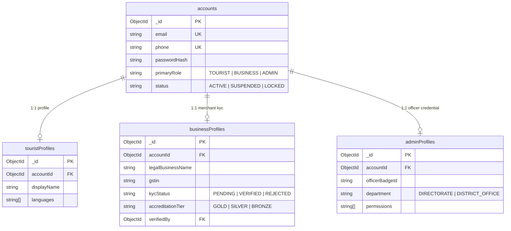

# Database Security, Compliance & Data Governance

## 1. Executive Summary

The Kerala Tourism digital ecosystem handles sensitive personal identity records, high-volume real-time geolocation points, and multi-party financial transactions. Maintaining rigorous security, confidentiality, and data integrity is paramount.

This document establishes the security architecture and compliance specifications across:
1. **Identity & Role Segregation** (preventing horizontal and vertical privilege escalation).
2. **Cryptographic Protection** (passwords, sessions, refresh tokens).
3. **Data Privacy & Statutory Compliance** (India's Digital Personal Data Protection (DPDP) Act 2023).
4. **Zero PCI-DSS Footprint** (statutory tokenization for payment processing).
5. **Role-Based Access Control (RBAC) & Multi-Tenant Query Isolation**.
6. **Immutable Audit Logging & Data Retention Policies**.

---

## 2. Account Architecture & Privilege Escalation Prevention

### 2.1 The Split-Identity Paradigm
A critical security risk in multi-sided platforms is **vertical privilege escalation**, where a regular consumer updates a profile field (e.g. `role: "HOST"` or `role: "ADMIN"`) to gain unauthorized merchant or administrative capabilities.

The architecture completely separates the **central authentication identity** from **role-specific capability profiles**:



### 2.2 Security Invariants
1. **Public Signup Boundary**:
   - The public registration endpoint (`POST /api/v1/auth/register`) can **only** provision an `accounts` record linked to a `touristProfiles` document.
   - It is programmatically impossible to instantiate an `adminProfiles` record via public routes.
2. **Business Capability Verification Gate**:
   - Creating a `businessProfiles` record requires a specialized onboarding journey (`POST /api/v1/agencies/onboard` or `POST /api/v1/properties/onboard`).
   - The profile is created with `kycStatus: "PENDING"`.
   - **Marketplace Isolation**: The query engine enforces `{ status: "ACTIVE", kycStatus: "VERIFIED" }` across all public destination, package, and accommodation listing searches. Unverified businesses cannot publish rooms, accept payments, or interact with tourists.
3. **Administrative Provisioning**:
   - `adminProfiles` documents are provisioned strictly via private root CLI scripts or approved internal directorate invitation tokens signed with administrative RSA-4096 keys.

---

## 3. Cryptographic Storage & Token Lifecycle

### 3.1 Password Hashing Standards
- **Algorithm**: `Argon2id` (recommended by OWASP) or `bcrypt` with cost factor $\ge 12$.
- **Pepper & Salt**: Cryptographically unique per-user 16-byte salt combined with a server-side hardware security module (HSM) / environment pepper.
- **Enforcement**: Plaintext passwords are never logged, never cached in memory, and never returned in API payloads (`select: false` on Mongoose schema).

### 3.2 Session & Refresh Token Lifecycle
- **Stateless Access Tokens**: Short-lived JWTs (15-minute lifespan) signed via asymmetric RS256 keys.
- **Stateful Refresh Tokens**:
  - Refresh tokens are **never stored in plaintext** in the database.
  - Upon issuance, the server generates a cryptographically secure 256-bit random string (`crypto.randomBytes(32).toString('hex')`).
  - Only the **one-way SHA-256 hash** of this token is stored in the `sessions` collection:
    ```typescript
    import crypto from 'node:crypto';

    function hashSessionToken(plainToken: string): string {
      return crypto.createHash('sha256').update(plainToken).digest('hex');
    }
    ```
  - When the client requests a token refresh, the provided token is hashed and queried:
    `{ tokenHash: hashSessionToken(incomingToken) }`.
  - **Automatic Expiration**: The `sessions` collection enforces a TTL index on `expiresAt` (`expireAfterSeconds: 0`), guaranteeing automatic document deletion upon session timeout.
  - **Immediate Revocation**: Logout, password reset, or suspicious IP detection immediately executes `deleteMany({ accountId: user._id })`.

---

## 4. DPDP Act 2023 & Sensitive PII Governance

In compliance with India's **Digital Personal Data Protection Act, 2023 (DPDP Act)**:

### 4.1 Masked Identity Storage
Government identity documents required for hotel guest check-in (Form C compliance) or business KYC (Aadhaar, Passport, PAN):
1. **Masked Storage in MongoDB**:
   - Aadhaar numbers **MUST NOT** be stored in full. Only the last 4 digits are persisted:
     `{ idType: "AADHAAR", maskedNumber: "XXXX-XXXX-8921" }`.
   - PAN numbers are formatted with first 3 and last 2 characters visible: `ABCXXXXX1F`.
2. **Encrypted Document Vault**:
   - Raw document images/PDFs are stored in an encrypted private cloud bucket (AWS S3 with KMS CMK or Google Cloud Storage with Customer-Managed Keys).
   - MongoDB only stores the UUID reference to the encrypted object:
     `{ documentStorageKey: "vault/kyc/2026/uuid-8f92b.enc" }`.
   - Access to raw documents requires short-lived pre-signed URLs (TTL $\le 60\text{ seconds}$) accessible only to verified District Tourism Officers during an active verification session.

### 4.2 Geo-Location Privacy & Fencing
- **Destination Submissions**: When eco-tourists crowdsource hidden destinations, their exact device GPS readings are segregated into `destinationSubmissions`.
- **Public Fencing**: Publicly displayed coordinates on `destinations` represent the centroid or officially designated park entry gate, preventing tourists from trampling fragile biodiversity zones or indigenous settlements.
- **Sensitive Forest Buffers**: Submissions within Silent Valley, Periyar Tiger Reserve core zones, or protected forest areas trigger an automated warning and require Forest Department clearance.

---

## 5. Zero PCI-DSS Card Storage Mandate

In strict compliance with **PCI-DSS Level 1** and Reserve Bank of India (RBI) mandates:

> [!CAUTION]
> **Absolute Zero Card Data Policy**:
> The Kerala Tourism backend database **NEVER receives, processes, or stores raw Primary Account Numbers (PAN), CVVs, magnetic stripe data, or card PINs**.

### 5.1 Payment Flow Architecture
1. The web/mobile frontend collects card details directly inside an isolated iframe hosted by the RBI-authorized payment aggregator (Razorpay, PayU, or Cashfree).
2. The aggregator returns a **tokenized payment ID** (`pay_Khd8923Nks`).
3. The server only records the gateway token and metadata:
   - `gatewayTransactionId`: `"pay_Khd8923Nks"`
   - `paymentMethod`: `"UPI"` | `"CARD"` | `"NETBANKING"`
   - `cardNetwork`: `"VISA"` | `"MASTERCARD"` | `"RUPAY"` (if card)
   - `cardLast4`: `"4242"` (if card)
4. No sensitive card data ever enters MongoDB memory buffers or database logs.

---

## 6. Multi-Tenant Isolation & Row-Level Authorization

To prevent cross-tenant data leaks (e.g. Property Owner A viewing bookings or guest manifests belonging to Property Owner B):

### 6.1 Tenant Scope Enforcement Rules
Every database read and write operation executed on behalf of a business user **MUST incorporate the tenant boundary** in the query predicate:

```typescript
// SECURE: Enforces tenant scoping
export async function getPropertyBookings(businessAccountId: ObjectId, propertyId: ObjectId) {
  // 1. Verify property belongs to the requesting business
  const property = await Property.findOne({ _id: propertyId, businessId: businessAccountId });
  if (!property) {
    throw new ForbiddenError('Access denied to property records');
  }

  // 2. Query bookings filtered by verified propertyId
  return Booking.find({ propertyId: property._id })
    .sort({ createdAt: -1 })
    .lean();
}
```

### 6.2 Role-Based Access Control (RBAC) Matrix

| Entity / Resource | Tourist | Business (Host / Agency) | Tourism Officer (Admin) | Public Unauthenticated |
|---|---|---|---|---|
| **Public Destinations** | Read | Read | Read / Write / Moderate | Read |
| **Crowdsourced Submissions** | Create own / Read own | Read verified | Review / Approve / Reject | None |
| **Properties & Rooms** | Read verified | Manage own inventory | Audit / Suspend | Read verified |
| **Bookings** | Create / View own | View own property bookings | Full audit access | None |
| **Guest Manifest (PII)** | View own | View checked-in guests | Law enforcement audit | None |
| **Financial Ledgers & Payouts**| None | View own payouts | View all platform balances | None |
| **Audit Logs** | None | None | Read-only | None |

---

## 7. Audit Logging & Soft-Delete Governance

### 7.1 Immutable Audit Logs (`auditLogs`)
All state-modifying actions across critical entities (KYC status changes, booking status transitions, financial adjustments, room pricing changes) are recorded in an append-only `auditLogs` collection:

- **Immutability Guarantee**: Database user roles granted to the Express application have `INSERT` and `READ` privileges on `auditLogs`, but strictly **no `UPDATE` or `DELETE` permissions**.
- **Audit Log Schema**:
  ```json
  {
    "_id": { "$oid": "672...a01" },
    "actorId": { "$oid": "672...101" },
    "actorRole": "ADMIN",
    "ipAddress": "103.24.12.55",
    "userAgent": "Mozilla/5.0 ...",
    "action": "PROPERTY_KYC_VERIFIED",
    "entityType": "PROPERTY",
    "entityId": { "$oid": "672...501" },
    "previousState": { "kycStatus": "PENDING" },
    "newState": { "kycStatus": "VERIFIED" },
    "timestamp": { "$date": "2026-11-10T08:30:00.000Z" }
  }
  ```

### 7.2 Soft-Delete Patterns & Data Retention
1. **Soft Delete Policy**:
   - Critical entities (`properties`, `rooms`, `travelPackages`, `posts`, `destinations`) implement soft-deletes via `{ isDeleted: true, deletedAt: ISODate }`.
   - Partial indexes (e.g. `{ isDeleted: 1 }` where `{ isDeleted: false }`) ensure soft-deleted records do not bloat index lookups.
2. **Statutory Retention Rules**:
   - **Financial & Booking Records**: Retained for **7 years** pursuant to the Indian Income Tax Act and GST regulations.
   - **Session Records**: Expired and pruned within **0 seconds** of expiration via MongoDB TTL indexes.
   - **Tourist UGC & Right to be Forgotten**: Upon tourist account deletion, social posts are anonymized or soft-deleted, but financial booking receipts remain locked for regulatory audits.
