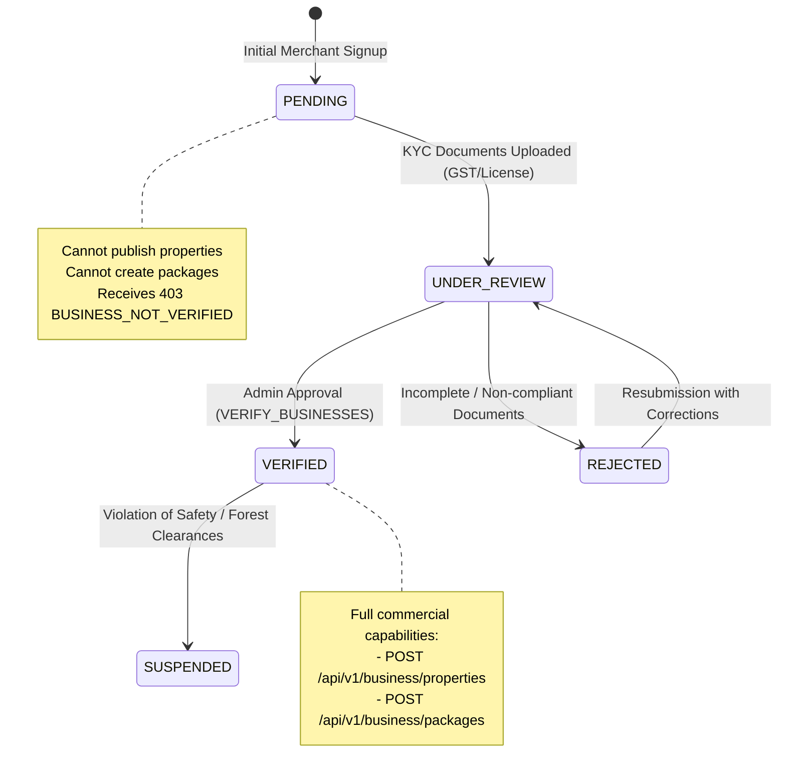

# Security Architecture: Authorization, RBAC & Resource Ownership Security

This document specifies the authorization, role-based access control (RBAC), and object-level ownership security architecture for the **Kerala Tourism** backend ecosystem.

---

## 1. Core Principles

1. **Least-Privilege Authorization**: Accounts only obtain permissions strictly required for their operational domain.
2. **Untrusted Client Inputs**: Authorization is established strictly from cryptographically validated JWT claims (`req.user.id`, `req.user.accountType`, `req.user.status`) issued by the server. Body parameters (`accountId`, `ownerId`, `accountType`, `role`, `permissions`) and query parameters (`?ownerId=...`) are explicitly disregarded or rejected via Zod strict schema validation (`.strict()`).
3. **Defense-in-Depth**: Authorization is verified at the route level via Express middleware (`requireAccountType`, `requirePermission`, `requireVerifiedBusiness`, `requireActiveAccount`) and enforced at the service/controller layer via direct identity anchoring (`assertOwnership`).
4. **Information Concealment**: Private resource unauthorized access returns `404 Not Found` rather than `403 Forbidden` to prevent object ID probing and Insecure Direct Object Reference (IDOR) existence enumeration.

---

## 2. Account Types & Role Boundaries

The platform operates on three distinct account identities anchored on [`AccountModel.accountType`](file:///c:/Users/aysha/Downloads/New%20folder/server/src/modules/auth/models/account.model.ts):

| Account Type | Description | Associated Profile Model | Key Capabilities |
|---|---|---|---|
| `TOURIST` | Leisure travelers, trekkers, and explorers | [`TouristProfileModel`](file:///c:/Users/aysha/Downloads/New%20folder/server/src/modules/users/models/touristProfile.model.ts) | Browse destinations, book transit stays and homestays, create travel posts, write verified reviews, manage personal bookings. |
| `BUSINESS` | Commercial hospitality & travel providers (Hotels, Resorts, Homestays, Travel Agencies) | [`BusinessProfileModel`](file:///c:/Users/aysha/Downloads/New%20folder/server/src/modules/users/models/businessProfile.model.ts) | Merchant portal, manage inventory, publish tour packages, process guest bookings (only when verified). |
| `ADMIN` | Department of Tourism officers, district regulators, and moderators | [`AdminProfileModel`](file:///c:/Users/aysha/Downloads/New%20folder/server/src/modules/users/models/adminProfile.model.ts) | Moderate community submissions, review business KYC documents, dispute resolution, audit logging, system settings. |

---

## 3. Administrative Permission Model

Administrative actions require granular permissions defined in [`ADMIN_PERMISSIONS`](file:///c:/Users/aysha/Downloads/New%20folder/packages/constants/src/index.ts). Admin accounts are assigned an array of permissions inside their database [`AdminProfile`](file:///c:/Users/aysha/Downloads/New%20folder/server/src/modules/users/models/adminProfile.model.ts), validated upon every privileged request by `requirePermission`:

| Permission Key | Description | Protected Operations |
|---|---|---|
| `VIEW_ANALYTICS` | Read-only access to ecosystem metrics, occupancy, and KPIs | `GET /api/v1/admin/dashboard` |
| `VIEW_DASHBOARD` | Operational summary counts across users, destinations, social posts, and business KYC | `GET /api/v1/admin/dashboard/overview` |
| `VIEW_USERS` | Read-only access to the user governance directory and safe profile details | `GET /api/v1/admin/users`, `GET /api/v1/admin/users/:userId` |
| `MANAGE_USERS` | User governance, directory lookup, and account reactivation | `GET /api/v1/admin/users`, `GET /api/v1/admin/users/:userId`, `PATCH /api/v1/admin/users/:userId/reactivate` |
| `SUSPEND_USERS` | Emergency suspension of compromised or abusive accounts + session revocation | `PATCH /api/v1/admin/users/:userId/suspend` |
| `VERIFY_BUSINESSES` | Approving or rejecting KYC applications for merchants | `PATCH /api/v1/admin/businesses/:businessId/verify` |
| `REJECT_BUSINESSES` | Rejecting incomplete or fraudulent merchant signups | Merchant rejection workflows |
| `APPROVE_BUSINESSES` | Legacy alias for business onboarding approval | Merchant onboarding pipelines |
| `VERIFY_DESTINATIONS` | Approving crowd-sourced tourist destinations (Day 11 legacy workflow) | `PATCH /api/v1/admin/destination-submissions/:id/review` |
| `VIEW_MODERATION_QUEUE` | Read-only access to the unified moderation queue and section triage lists (Day 18) | `GET /api/v1/admin/moderation/queue` and `GET /api/v1/admin/moderation/*` lists |
| `MODERATE_DESTINATIONS` | Approving or rejecting community destination submissions into VERIFIED DRAFT destinations (Day 18) | `GET /api/v1/admin/moderation/destinations`, `PATCH /api/v1/admin/moderation/destinations/:submissionId/approve\|reject` |
| `MODERATE_POSTS` | Approving, rejecting, or soft-removing community social posts (Day 18) | `GET /api/v1/admin/moderation/posts`, `PATCH /api/v1/admin/moderation/posts/:postId/approve\|reject\|remove` |
| `MANAGE_DESTINATIONS` | Editing destination boundaries, forest clearances, and metadata | Geographic master data management |
| `MODERATE_COMMENTS` | Soft-removing violating comments and restoring moderator-removed comments (Day 18) | `GET /api/v1/admin/moderation/comments`, `PATCH /api/v1/admin/moderation/comments/:commentId/remove\|restore` |
| `REVIEW_REPORTS` | Reviewing and resolving/dismissing community abuse reports (Day 18) | `GET /api/v1/admin/moderation/reports`, `PATCH /api/v1/admin/moderation/reports/:reportId/review` |
| `MANAGE_BOOKINGS` | Overseeing high-value disputes and emergency booking interventions | Dispute resolution portal |
| `VIEW_AUDIT_LOGS` | Inspecting cryptographic audit trails and administrative actions | Security compliance review |
| `MANAGE_SYSTEM_SETTINGS` | Adjusting global operational policies and SLAs | System configuration |
| `HANDLE_DISPUTES` | Mediating financial and cancellation disputes | Merchant-tourist dispute arbitration |

---

## 4. Business Verification Lifecycle & Restrictions

Merchant accounts register with an initial `verificationStatus: PENDING`. Commercial stay and package management is gated strictly by `requireVerifiedBusiness`:

---

## 5. Resource Ownership & BOLA / IDOR Prevention

### Broken Object Level Authorization (BOLA) Defense Matrix:

| Domain Resource | Access Method | Ownership Determination | Unauthorized Access Response |
|---|---|---|---|
| **Tourist Profile** | `GET/PATCH /api/v1/tourist/profile` | Direct derivation: `req.user.id`. Client-provided `accountId` in body/query is rejected via Zod `.strict()`. | `400 Bad Request` if field injected; query param ignored. |
| **Tourist Posts** | `GET/PATCH/DELETE /api/v1/tourist/posts/:postId` | `post.authorId === req.user.id` (`authorId` strictly derived from JWT on creation). | `404 Not Found` (`RESOURCE_NOT_FOUND` concealed). |
| **Tourist Comments** | `PATCH/DELETE /api/v1/tourist/comments/:commentId` | `comment.authorId === req.user.id` (`authorId` derived strictly from JWT on creation). | `404 Not Found` (`RESOURCE_NOT_FOUND` concealed). |
| **Tourist Likes & Reposts** | `DELETE /api/v1/tourist/posts/:postId/likes`, `/reposts` | Scoped strictly to `{ accountId: req.user.id, postId }` (`accountId` from JWT). | `404 Not Found` (`RESOURCE_NOT_FOUND`). |
| **Business Profile** | `GET/PATCH /api/v1/business/profile` | Direct derivation: `req.user.id`. | `400 Bad Request` if field injected; query param ignored. |
| **Properties** | `PATCH /api/v1/business/properties/:propertyId` | `property.ownerId === req.user.id`. | `404 Not Found` (Resource existence concealed). |
| **Tour Packages** | `PATCH /api/v1/business/packages/:packageId` | `package.agencyId === req.user.id`. | `404 Not Found` (Resource existence concealed). |
| **Bookings** | `GET /api/v1/business/bookings/:bookingId` | Booking's `propertyId` matches a property where `property.ownerId === req.user.id`. | `404 Not Found` (Resource existence concealed). |

### Error Status Conventions:
- **`401 Unauthorized` (`AUTHENTICATION_REQUIRED`, `TOKEN_EXPIRED`, `INVALID_TOKEN`)**: The request lacks valid bearer authentication.
- **`403 Forbidden` (`FORBIDDEN_ACCOUNT_TYPE`, `INSUFFICIENT_PERMISSIONS`, `BUSINESS_NOT_VERIFIED`, `ACCOUNT_SUSPENDED`, `ACCOUNT_DEACTIVATED`)**: The client is authenticated, but their account type or verification status lacks authorization.
- **`404 Not Found` (`RESOURCE_NOT_FOUND`)**: Used deliberately when an authorized caller attempts to access a specific private object ID owned by another user. This prevents ID enumeration attacks (where a malicious user checks whether random IDs return 403 vs 404).

---

## 6. Protected Example Routes

| Endpoint | Method | Middleware Chain | Description |
|---|---|---|---|
| `/api/v1/tourist/profile` | `GET` | `authenticate`, `requireAccountType('TOURIST')` | Read own tourist profile |
| `/api/v1/tourist/profile` | `PATCH` | `authenticate`, `requireAccountType('TOURIST')`, `validateBody(updateTouristProfileSchema)` | Update own tourist profile |
| `/api/v1/tourist/posts` | `POST` | `postCreationRateLimiter`, `authenticate`, `requireActiveAccount`, `requireAccountType('TOURIST')`, `validateBody(createPostSchema)` | Create tourist post |
| `/api/v1/tourist/posts/:postId` | `GET/PATCH/DELETE` | `authenticate`, `requireActiveAccount`, `requireAccountType('TOURIST')` | Read/update/soft-delete own post |
| `/api/v1/tourist/feed/following` | `GET` | `authenticate`, `requireActiveAccount`, `requireAccountType('TOURIST')`, `validateQuery(followingFeedQuerySchema)` | Retrieve personalized cursor-paginated feed of followed active tourists |
| `/api/v1/tourist/posts/:postId/likes` | `POST/DELETE` | `engagementRateLimiter` (POST), `authenticate`, `requireActiveAccount`, `requireAccountType('TOURIST')` | Like / unlike eligible published post |
| `/api/v1/tourist/posts/:postId/comments` | `POST` | `engagementRateLimiter`, `authenticate`, `requireActiveAccount`, `requireAccountType('TOURIST')`, `validateBody(createCommentSchema)` | Comment on eligible published post |
| `/api/v1/tourist/comments/:commentId` | `PATCH/DELETE` | `authenticate`, `requireActiveAccount`, `requireAccountType('TOURIST')` | Edit/soft-delete own comment (`404` BOLA) |
| `/api/v1/tourist/posts/:postId/reposts` | `POST/DELETE` | `engagementRateLimiter` (POST), `authenticate`, `requireActiveAccount`, `requireAccountType('TOURIST')` | Repost / unrepost eligible published post |
| `/api/v1/business/profile` | `GET` | `authenticate`, `requireAccountType('BUSINESS')` | Read own business profile |
| `/api/v1/business/profile` | `PATCH` | `authenticate`, `requireAccountType('BUSINESS')`, `validateBody(updateBusinessProfileSchema)` | Update own business profile |
| `/api/v1/business/dashboard` | `GET` | `authenticate`, `requireAccountType('BUSINESS')` | Access merchant operational dashboard |
| `/api/v1/business/properties` | `POST` | `authenticate`, `requireAccountType('BUSINESS')`, `requireVerifiedBusiness`, `validateBody(createPropertySchema)` | Create verified stay property |
| `/api/v1/business/packages` | `POST` | `authenticate`, `requireAccountType('BUSINESS')`, `requireVerifiedBusiness`, `validateBody(createTourPackageSchema)` | Create verified tour package |
| `/api/v1/business/properties/:propertyId` | `PATCH` | `authenticate`, `requireVerifiedBusiness` | Update own property |
| `/api/v1/business/packages/:packageId` | `PATCH` | `authenticate`, `requireVerifiedBusiness` | Update own package |
| `/api/v1/business/bookings/:bookingId` | `GET` | `authenticate`, `requireAccountType('BUSINESS')` | Inspect booking for own property |
| `/api/v1/admin/dashboard` | `GET` | `authenticate`, `requireActiveAccount`, `requireAccountType('ADMIN')`, `requirePermission('VIEW_ANALYTICS')` | Access Day 10 KPI dashboard |
| `/api/v1/admin/dashboard/overview` | `GET` | `authenticate`, `requireActiveAccount`, `requireAccountType('ADMIN')`, `requirePermission('VIEW_DASHBOARD')` | Operational summary statistics across platform collections |
| `/api/v1/admin/users` | `GET` | `authenticate`, `requireActiveAccount`, `requireAccountType('ADMIN')`, `requireAnyPermission(['VIEW_USERS', 'MANAGE_USERS'])`, `validateQuery(adminUsersQuerySchema)` | Paginated, filtered user directory with safe batched profile summaries |
| `/api/v1/admin/users/:userId` | `GET` | `authenticate`, `requireActiveAccount`, `requireAccountType('ADMIN')`, `requireAnyPermission(['VIEW_USERS', 'MANAGE_USERS'])`, `validateParams(adminUserIdParamSchema)` | Safe account details and polymorphic profile summary (no secrets/storage keys) |
| `/api/v1/admin/users/:userId/suspend` | `PATCH` | `authenticate`, `requireActiveAccount`, `requireAccountType('ADMIN')`, `requirePermission('SUSPEND_USERS')`, `adminMutationRateLimiter`, `validateParams`, `validateBody(suspendUserSchema)` | Suspend active account, enforce privilege hierarchy, revoke sessions, append audit log |
| `/api/v1/admin/users/:userId/reactivate` | `PATCH` | `authenticate`, `requireActiveAccount`, `requireAccountType('ADMIN')`, `requirePermission('MANAGE_USERS')`, `adminMutationRateLimiter`, `validateParams`, `validateBody(reactivateUserSchema)` | Reactivate suspended account without restoring sessions, append audit log |
| `/api/v1/admin/businesses/:businessId/verify` | `PATCH` | `authenticate`, `requirePermission('VERIFY_BUSINESSES')`, `validateBody(verifyBusinessActionSchema)` | Update merchant verification status |
| `/api/v1/tourist/users/:userId/follow` | `POST` | `followRateLimiter`, `authenticate`, `requireActiveAccount`, `requireAccountType('TOURIST')`, `validateParams(userIdParamSchema)`, `validateBody(followActionBodySchema)` | Follow another active tourist (`404` anti-enumeration on inactive/non-tourist targets) |
| `/api/v1/tourist/users/:userId/follow` | `DELETE` | `followRateLimiter`, `authenticate`, `requireActiveAccount`, `requireAccountType('TOURIST')`, `validateParams(userIdParamSchema)`, `validateBody(followActionBodySchema)` | Unfollow an account (`followerId` derived strictly from caller JWT) |
| `/api/v1/users/:userId/followers` | `GET` | `validateParams(userIdParamSchema)`, `validateQuery(followListQuerySchema)` | Public paginated followers of active tourist (safe DTO, no PII) |
| `/api/v1/users/:userId/following` | `GET` | `validateParams(userIdParamSchema)`, `validateQuery(followListQuerySchema)` | Public paginated following of active tourist (safe DTO, no PII) |
| `/api/v1/tourist/reports` | `POST/GET` | `reportRateLimiter` (POST), `authenticate`, `requireActiveAccount`, `requireAccountType('TOURIST')`, `validateBody`/`validateQuery` | Submit content report (`reporterId` from JWT, self/duplicate blocked) & list own reports without moderator notes |
| `/api/v1/admin/moderation/*` | `GET/PATCH` | `authenticate`, `requireActiveAccount`, `requireAccountType('ADMIN')`, `requirePermission`/`requireAnyPermission`, `moderationRateLimiter` (PATCH), `validate*` | Centralized Day 18 moderation queue, destination/post/comment moderation, and report triage (see [`moderation-security.md`](./moderation-security.md)) |

---

## 7. Admin Privilege Hierarchy & Immutable Audit Guarantees (Day 17)

- **Privilege Levels (`ADMIN_LEVELS`)**: Ranked `SUPER_ADMIN` (`3`) > `DISTRICT_OFFICER` (`2`) > `MODERATOR` (`1`). Administrators cannot suspend/modify themselves (`403`), cannot modify higher-ranked admins (`403`), and non-`SUPER_ADMIN` callers cannot modify equal-rank peer admins (`403`). Targets with missing `AdminProfile` records fail closed.
- **Session Revocation Without Silent Restoration**: Account suspension revokes all active `SessionModel` entries atomically (`revocationReason: 'ADMIN_SUSPENSION'`). Reactivation restores `ACTIVE` account status only — revoked sessions remain permanently revoked until the user signs in again.
- **Append-Only `auditLogs`**: Sensitive admin mutations atomically insert an `AuditLogModel` record (sanitized reason, safe `beforeState`/`afterState`, acting admin ID/level, target ID, `ipAddress`, `userAgent`, `timestamp`), protected against updates/deletes by Mongoose pre-hooks and absence of mutation APIs.
