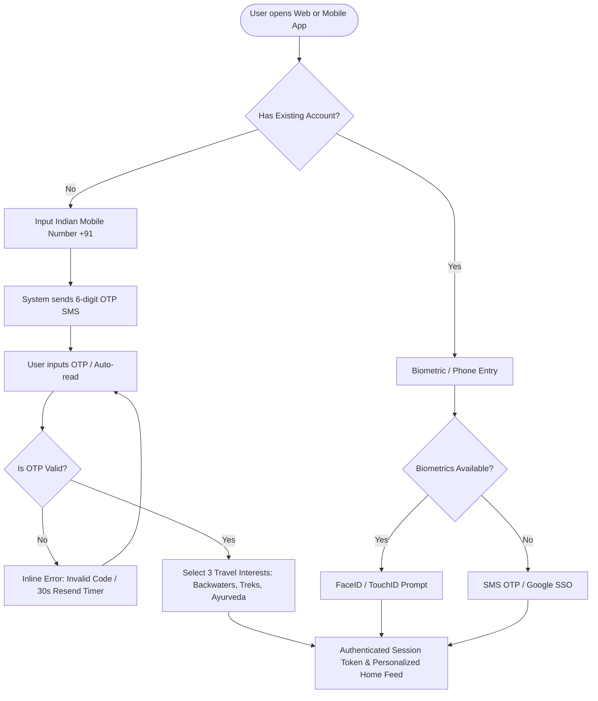
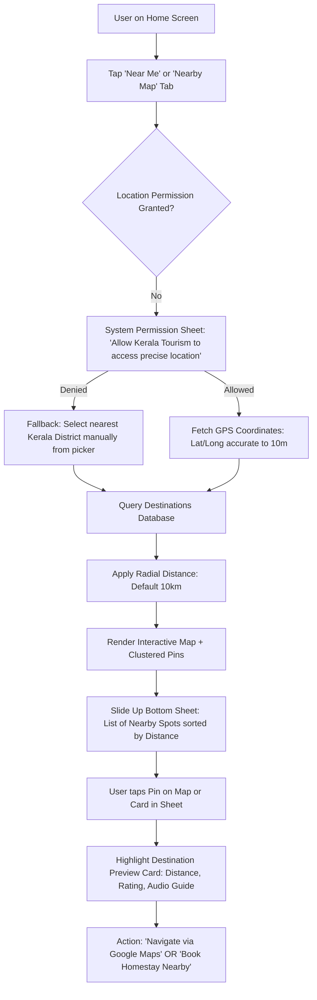
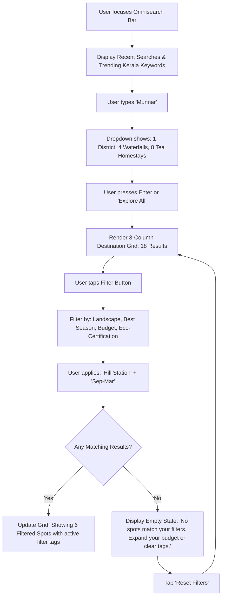
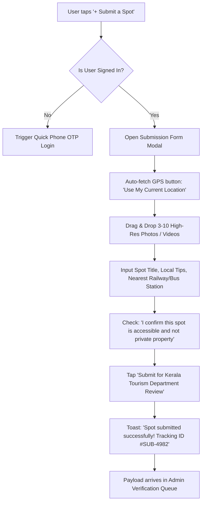
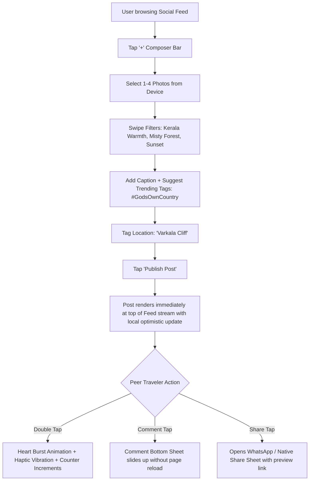
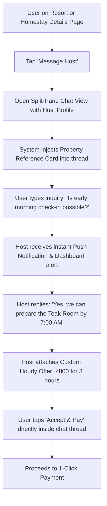
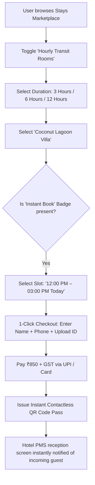
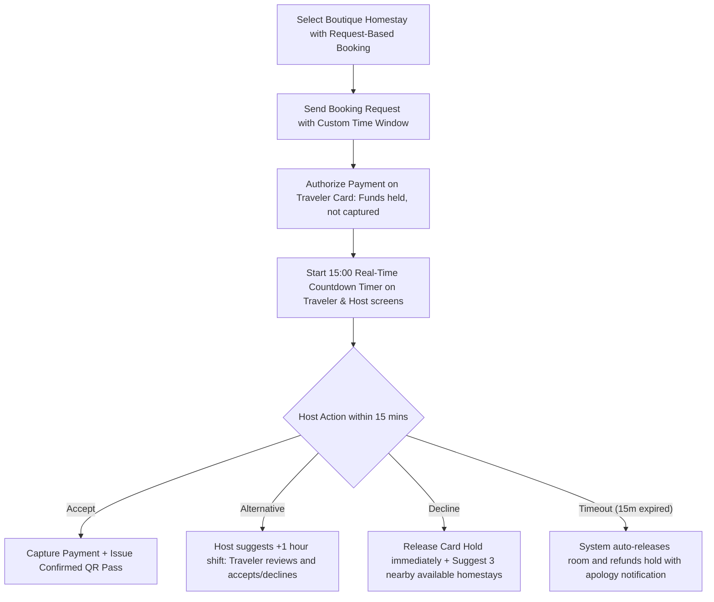

# Interactive UX Workflows & User Flow Architecture (Workflows A – K)
**Kerala Tourism Ecosystem**  
**Standards:** Full state coverage (Happy path, edge cases, error recovery, empty & loading states)

---

## Master Workflow Directory

- **Workflow A:** Tourist Registration & Frictionless Login (OTP & Biometric)
- **Workflow B:** GPS-Based Destination Discovery (Radial Proximity & Map Sync)
- **Workflow C:** Manual Destination Search & Multi-Parameter Filter Engine
- **Workflow D:** Community Destination Submission (Crowdsourced Eco-Sanctuaries)
- **Workflow E:** Social Post Creation, Engagement & Double-Tap Interactions
- **Workflow F:** Direct Inquiries & Host Messaging (With Itinerary Attachments)
- **Workflow G:** Multi-Day Travel Tour Package Booking
- **Workflow H:** Instant Hourly & Daily Room Booking (Contactless QR Pass)
- **Workflow I:** Request-Based Room Booking (15-Minute Host Countdown Engine)
- **Workflow J:** Admin Destination Verification (Geofence & Toxicity Inspection)
- **Workflow K:** Business Onboarding, Document Verification & Inventory Activation

---

## 1. Workflow A: Tourist Registration and Login



### UX States & Edge Cases:
- **Happy Path:** Phone number entered → Auto-read OTP fills in 2 seconds → 3 interest chips tapped → lands on personalized home.
- **Edge Case 1 (Delayed SMS):** After 30 seconds, a secondary button appears: "Send OTP via WhatsApp" or "Call Me with Code".
- **Edge Case 2 (Roaming International Traveler):** Option to switch country code (+44, +1, +971) or authenticate via Google/Apple Single Sign-On without local SIM.

---

## 2. Workflow B: GPS-Based Destination Discovery



---

## 3. Workflow C: Manual Destination Search & Multi-Filter Engine



---

## 4. Workflow D: Community Destination Submission



---

## 5. Workflow E: Social Post Creation & Interactions



---

## 6. Workflow F: Direct Inquiries & Host Messaging



---

## 7. Workflow G: Travel Package Booking

```mermaid
flowchart TD
    Browse[Browse Curated Travel Packages] --> SelectPkg[Select '4D/3N Backwater & Tea Estate Trail']
    SelectPkg --> ReviewItinerary[Review Day-by-Day Accordion Timeline & Agency License]
    ReviewItinerary --> DateSelect[Select Departure Date from Availability Calendar]
    DateSelect --> TravelersCount[Choose Travelers: 2 Adults, 1 Child]
    TravelersCount --> AddOns[Optional Add-on: 'Private Airport Chauffeur from Kochi (+₹2,200)']
    
    AddOns --> ProceedCheckout[Tap 'Proceed to Checkout']
    ProceedCheckout --> SummaryCard[Display Itemized Cost, GST, and Agency Cancellation Policy]
    SummaryCard --> CompletePayment[Pay 25% Advance via UPI / NetBanking]
    CompletePayment --> PassIssued[Instant Package Itinerary PDF + WhatsApp Confirmation Dispatched]
```

---

## 8. Workflow H: Instant Hourly & Daily Room Booking



---

## 9. Workflow I: Request-Based Room Booking (15-Minute Countdown)



---

## 10. Workflow J: Admin Destination Verification

```mermaid
flowchart TD
    AdminLogin[Tourism Department Officer logs into Admin Console] --> OpenQueue[Navigate to 'Destination Verification Queue' (8 Pending)]
    OpenQueue --> SelectSubmission[Select #SUB-4982: Cheeyappara Lower Cascades]
    
    SelectSubmission --> InspectionTools[Side-by-Side Review Tool]
    InspectionTools --> CheckGPS[Validate GPS against Forest Dept Buffer Boundaries]
    InspectionTools --> CheckToxicity[Automated Image Safety Scan: 100% Safe, Original EXIF data verified]
    InspectionTools --> CheckDuplication[Check nearest existing spots within 500m radius]
    
    CheckDuplication --> Decision{Inspector Decision}
    Decision -- Approve --> PublishLive[Tag with 'Verified Community Spot' & Publish to Public Explore Stream]
    Decision -- Need More Info --> RequestFieldAudit[Assign Local District Tourism Officer for physical site audit]
    Decision -- Reject --> RejectForm[Select reason: Restricted Wildlife Corridor / Private Estate]
    RejectForm --> NotifyUser[Notify submitting traveler with feedback]
```

---

## 11. Workflow K: Business Registration & Compliance Verification

```mermaid
flowchart TD
    PartnerCTA[Operator clicks 'Partner With Us / List Your Stay'] --> RoleSelect[Select: Homestay / Hotel / Resort / Travel Agency]
    RoleSelect --> WizardStep1[Step 1: Business Profile, Property Address, Satellite Pin]
    WizardStep1 --> WizardStep2[Step 2: Upload Documents: GSTIN, Panchayat License, Host Police Verification]
    WizardStep2 --> WizardStep3[Step 3: Setup Bank Details for Automated Payouts (IFSC/Account)]
    WizardStep3 --> WizardStep4[Step 4: Configure Room Inventory & Hourly Rates (₹)]
    
    WizardStep4 --> SubmitKYC[Submit Application for Directorate Accreditation]
    SubmitKYC --> PendingState[Dashboard activated in 'Sandbox Review' Mode]
    PendingState --> AdminInspection[Tourism Inspector verifies documents & dispatches field rating]
    AdminInspection --> GrantBadge[Approve Account: Award Kerala Tourism Gold/Silver Accreditation Badge]
    GrantBadge --> GoLive[Property and Rooms go live on Public Marketplace]
```
